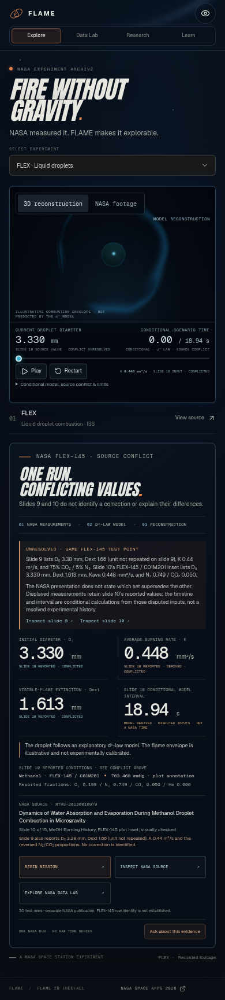
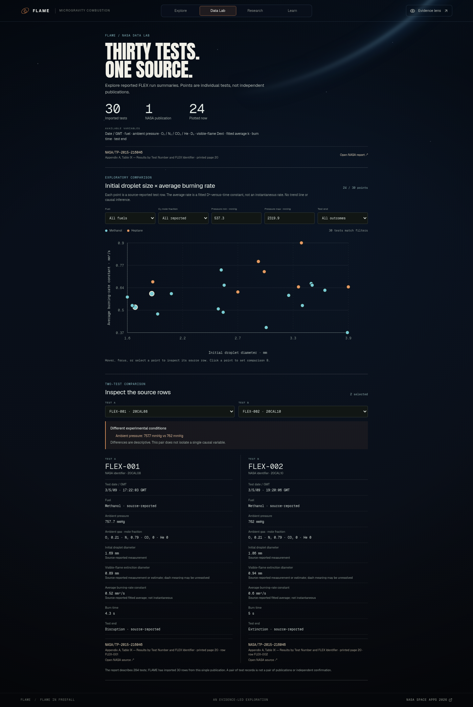
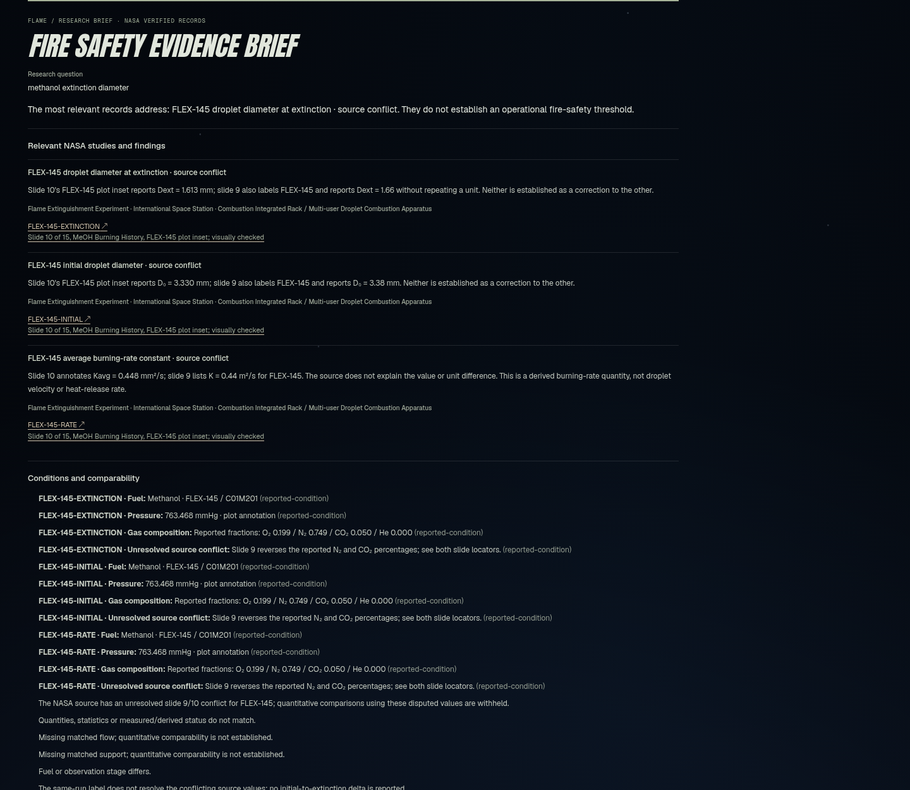

# FLAME — Fire in Low-gravity: Analysis, Modeling & Exploration

**NASA measured it. FLAME makes it explorable.** FLAME is an interactive science platform by **The88Bits** for learning from NASA's microgravity combustion research. It keeps source-reported evidence, model calculations, and illustrative reconstruction visibly distinct. FLAME is an independent project and is not endorsed by NASA.

## Explore FLAME

FLAME brings four working sections together:

- **Explore** — inspect a FLEX-inspired 3D reconstruction, source notes, archival material, and a scrub-able droplet d²-law scenario.
- **Data Lab** — filter and compare 30 individually indexed FLEX tests using source-reported fields, with missing values and comparability limits preserved.
- **Research** — search the curated evidence, inspect citations and limitations, and build a deterministic Fire Safety Evidence Brief. A server-side Gemini assistant can explain retrieved evidence when configured and available.
- **Learn** — predict, explore, explain, and verify how droplet diameter behaves in the simplified model.

The Research and Data Lab paths remain available when Gemini is unconfigured or unavailable.

## Product screenshots

These screenshots are captured from the running application; they are not design mockups.

| Explore | NASA Data Lab | Evidence Brief |
| --- | --- | --- |
|  |  |  |

## Evidence and provenance

The Data Lab indexes **30 individual FLEX tests from one NASA publication**, NASA/TP-2015-216046, *Detailed Results From the Flame Extinguishment Experiment (FLEX), March 2009 to December 2011*, Appendix A, Table IX (printed page 20). This is a focused imported batch, not all 284 tests mentioned by the report and not 30 independent publications. Each row retains its test identifier, reported fields, units, missing-data markers, qualifiers, and table/page provenance. Original source: [NASA NTRS 20150023456](https://ntrs.nasa.gov/citations/20150023456).

The separate FLEX-145 explanatory model uses records associated with NASA presentation [NTRS 20130010979](https://ntrs.nasa.gov/citations/20130010979). It is **not silently joined to the 30-row dataset**: an exact row identity has not been established. The presentation's slides 9 and 10 both label FLEX-145 and give conflicting diameter, burning-rate/unit, and diluent details. The source does not resolve the discrepancy. FLAME preserves this warning; displayed slide-10 values and the timeline are conditional scenarios, not resolved canonical values.

## Physics and interpretation limits

The optional droplet timeline evaluates the simplified relation `D(t)² = D₀² − Kt` over a finite interval. It shows source-associated endpoints separately from model-derived intermediate states. The burning-rate parameter is an average, not an instantaneous measurement; the source provides no raw time series, fitting interval, or uncertainty. This is an explanatory, conditional model for one reported run, not a validated general combustion or fire-safety predictor. It does not predict flame-envelope radius, temperature, color, chemistry, or airflow response. The 3D envelope is labeled **MODEL RECONSTRUCTION** and remains illustrative, not experimentally calibrated.

Read the project notes: [physics model and limits](PHYSICS_SPEC.md) · [evidence and system scope](FLAME_SPEC.md).

## Gemini assistant

When configured, the assistant retrieves a bounded set of FLAME evidence before generating an answer. Server-side validation ties citations to trusted application records and rejects unsupported quantitative claims. It can still return provider, quota, timeout, or validation errors; it is not a substitute for inspecting the cited NASA source. Gemini is optional: deterministic evidence search, Data Lab, and Evidence Brief do not depend on it. The API key is server-only and must never be added to client code or committed.

## Architecture

- **Next.js App Router / React / TypeScript** — application shell and API routes.
- **`components/`** — Explore scene and instrument, section navigation, Data Lab, learning mission, and Research interfaces.
- **`lib/research/`** — typed NASA corpus, 30-test dataset, search/ranking, comparison safeguards, and citation grounding.
- **`lib/physics/`** — pure droplet d²-law calculation used by the Explore timeline.
- **`app/api/`** — server-side deterministic research and optional Gemini endpoints.
- **`tests/`** — focused scientific/data tests and browser interaction tests.

## Run locally

Requirements: Node.js compatible with the installed Next.js version and npm.

```bash
npm ci
cp .env.example .env.local   # optional; add the key locally to enable Gemini
npm run dev
```

Open [http://localhost:3000](http://localhost:3000). `GOOGLE_GENERATIVE_AI_API_KEY` enables Gemini on the server. `GEMINI_MODEL` optionally overrides the route's default. Keep `.env.local` private; `.env.example` contains no credentials.

## Verify

```bash
npm test
npm run typecheck
npm run lint
npm run build
npm run test:e2e
```

The browser suite may require a locally installed Chromium. Gemini-dependent checks require valid server configuration; deterministic scientific tests do not.

## Team

**The88Bits** · NASA Space Apps Challenge 2026
